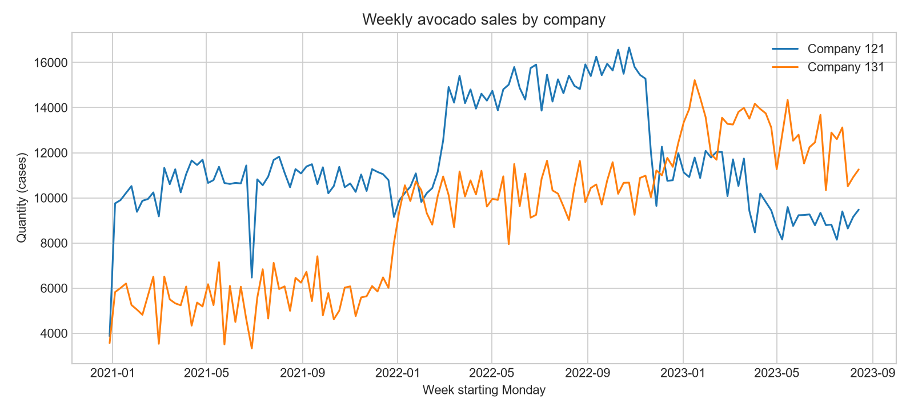
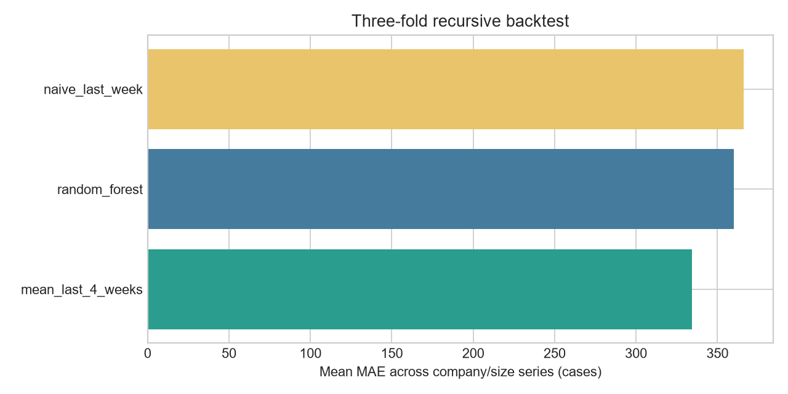

# Avocado Demand Forecasting

**Data science internship project by Anmar Ali Al-Taani**

A reproducible Python workflow for cleaning avocado sales records, summarizing customer purchasing frequency, and forecasting four weeks of demand for each company and avocado size.

This repository revisits an older internship project and consolidates its experimental notebooks into a documented workflow. The dataset was supplied during the internship; its provider permitted publication on GitHub, as confirmed by the author. The results below come from the revised workflow and should not be attributed to the original internship implementation.



## Project at a glance

| Item | Value |
| --- | --- |
| Original dataset | 11,386 rows, 13 columns |
| Recorded dates | January 1, 2021 - August 20, 2023 |
| Companies | 2 |
| Target avocado sizes | 32, 48, 60 |
| Case-unit rows used after cleaning | 11,055 |
| Weekly observations | 828 across 6 company/size series |
| Forecast horizon | 4 weeks per series, 24 predictions |
| Model | Random Forest regressor, 200 trees |
| Evaluation | 3 expanding-window folds, 4 recursive weeks each |

**These are historical forecasts beginning August 21, 2023, not forecasts for today's sales.** The first recorded week is partial. The last recorded date is a Sunday, completing its calendar week, but calendar coverage alone cannot establish that every transaction is present.

## What the workflow does

1. Loads the original CSV, normalizes column names, and parses month/day/year dates.
2. Removes 48 exact duplicate rows, excludes 246 kilogram-unit rows from the case-demand model, and then excludes 37 case-unit rows with unsupported or unresolved sizes. Missing size/type fields are recovered from product codes where possible. The original CSV retains every row.
3. Aggregates quantities by company, size, and Monday-starting week. Missing weeks after a series begins are explicitly assumed to have zero sales; none needed insertion in this dataset.
4. Builds predictors using only earlier quantities: four weekly lags, their mean, and sine/cosine encoding of week of year. The current target quantity is never a predictor.
5. Evaluates recursive four-step forecasts at three chronological cutoffs. Predictions feed subsequent lag features; actual quantities inside each forecast horizon do not.
6. Compares the model with last-week and four-week-average baselines, then refits on all available history and exports the historical four-week forecast.
7. Produces descriptive customer segments based on distinct order counts. These are frequency buckets, not inferred customer loyalty or seasonality.

## Evaluation results

Pooled errors across 72 predictions: 6 series x 3 folds x 4 weeks. Lower is better; units are cases.

| Method | MAE | RMSE |
| --- | ---: | ---: |
| Random Forest | 360.07 | 456.10 |
| Last observed week | 365.94 | 480.17 |
| Mean of last 4 weeks | **334.24** | **408.83** |

The Random Forest improves on last-week persistence, but **the four-week-average baseline has better MAE and RMSE than the Random Forest**. This is evidence for comparing models against simple alternatives, not a claim that machine learning always wins. No business uplift or production performance is claimed. Both model and baseline forecasts are exported for comparison.



The chart averages MAE equally across the six series. Each series contributes the same number of predictions, so this equals pooled MAE here. Detailed predictions and per-series scores are included for inspection.

## Run locally

Use Python 3.10 or newer. From this repository's folder:

```bash
python -m venv .venv
# Windows PowerShell:
.venv\Scripts\Activate.ps1
# macOS / Linux:
# source .venv/bin/activate
python -m pip install -r requirements.txt
python forecast.py
python -m unittest discover -s tests -v
```

Optional arguments:

```bash
python forecast.py --input data/demand_sales_data.csv --output-dir results --trees 200
```

For an illustrated walkthrough, launch `jupyter lab` and open [Avocado_Demand_Forecasting.ipynb](Avocado_Demand_Forecasting.ipynb) from the repository root. The notebook uses the same implementation as the script.

## Repository contents

| Path | Purpose |
| --- | --- |
| `forecast.py` | Cleaning, aggregation, backtesting, forecasts, segmentation, and charts |
| `Avocado_Demand_Forecasting.ipynb` | Documented walkthrough with saved results |
| `data/demand_sales_data.csv` | Unmodified internship dataset |
| `data/README.md` | Data provenance and interpretation |
| `results/` | Reproducible charts, audit, forecasts, and evaluation snapshots |
| `tests/test_forecast.py` | Regression tests for time boundaries, recursive lags, calendar gaps, and nonnegative forecasts |
| `requirements.txt` | Runtime and notebook dependencies |

`customer_segments.csv` is generated locally in `results/`; it is not committed because the original input already contains the necessary records.

## Assumptions and limitations

- The CSV mixes cases and kilograms. Only case-unit rows enter the model; no unsupported unit conversion is attempted. The complete source dataset remains included. The data documentation does not establish whether the source represents actual, anonymized, or simulated company transactions.
- Exact duplicate rows are removed as a cleaning assumption. Identical rows could represent valid transactions; source-system confirmation would be required for operational use.
- Missing calendar weeks are treated as zero demand. Change this policy if missing records mean unavailable data rather than no sales.
- Each series has its own model. Results pool errors in quantity units, so larger-volume series influence the overall error magnitude more.
- The three folds cover only the final twelve weeks. There is no independent post-development test period, prediction interval, hyperparameter search, or production monitoring.
- Random Forests do not extrapolate trends well, and recursive forecasts accumulate error. Baselines remain useful alternatives.
- Calendar, promotions, inventory limits, stockouts, weather, and other external demand drivers are not modeled.
- Original draft notebook filenames and saved errors are not part of the final workflow. Original local files remain unchanged.

## Author

**Anmar Ali Al-Taani** · Artificial Intelligence and Robotics student, Jadara University  
[GitHub](https://github.com/Anmar-962) · [LinkedIn](https://www.linkedin.com/in/anmar-taani-65351b285/)

No code or dataset redistribution license has been selected for this repository.
